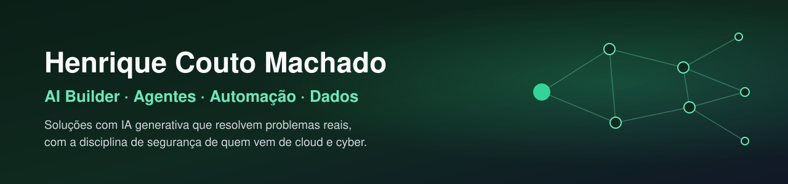

Construo **soluções com IA generativa que resolvem problemas de negócio de ponta a ponta**: agentes que executam tarefas, automações que tiram trabalho manual do caminho e análises de dados que viram decisão.

Venho de **cloud e cibersegurança**, e isso aparece no jeito de construir: o modelo interpreta e o código confere, ações sensíveis passam por aprovação humana, segredos nunca entram no repositório e resultado só é afirmado depois de medido.

---

### 🚀 Projeto em destaque

#### [🗂️ AI Business Operations Agent](https://github.com/henriquecm02/ai-business-operations-agent)

Um agente que recebe um pedido em português e transforma uma pasta de notas fiscais, faturas, e-mails de cobrança e contratos em **planilha, gráficos e relatório executivo**, apontando cobranças duplicadas, totais divergentes e vencimentos.

| | |
|---|---|
| **Como funciona** | Gemini com *function calling* orquestra ferramentas de extração, análise (pandas), planilha, gráficos e relatório; um **revisor independente** confere o resultado; ações sensíveis exigem **aprovação humana** |
| **Resultados medidos** | 2 de 2 problemas plantados detectados · 0 valores inventados no relatório · 98% de acurácia na extração · 28 s do pedido aos arquivos prontos ([benchmark reproduzível](https://github.com/henriquecm02/ai-business-operations-agent#resultados-medidos)) |
| **Também tem** | Servidor **MCP**, dashboard em Streamlit, prompts versionados com comparação v1 → v2, testes offline e CI |

---

### 🧩 Mais projetos de IA

| Projeto | O que faz | Destaque técnico |
|---|---|---|
| [📈 intelligent-data-dashboard](https://github.com/henriquecm02/intelligent-data-dashboard) | Coleta câmbio, juros e inflação do Banco Central, dispara alertas e tem um dashboard com resumo semanal por IA | Coleta incremental; todo número do texto da IA é conferido contra os dados |
| [⚙️ ai-workflow-automation](https://github.com/henriquecm02/ai-workflow-automation) | 5 workflows de n8n: triagem de e-mails, documentos, atas, pesquisa com fontes e boletim de indicadores | Workflows gerados por código; teste de ponta a ponta no **n8n real** (11/11 com Gemini simulado; 10 casos também com o Gemini real) e CI |
| [📚 ai-knowledge-assistant](https://github.com/henriquecm02/ai-knowledge-assistant) | RAG sobre políticas internas, com documento, seção e página de cada resposta | Busca BM25 + embeddings com RRF e reordenação; citações verificadas; 38 perguntas medidas com o Gemini real (híbrido 37/38; 38/38 com reordenação e com busca densa) |
| [🛋️ marketplace-business-intelligence](https://github.com/henriquecm02/marketplace-business-intelligence) | BI de um marketplace fictício e um analista de IA que responde perguntas da diretoria | Dados sintéticos com gabarito; SQL somente leitura; análises verificáveis |
| [🗓️ ai-productivity-copilot](https://github.com/henriquecm02/ai-productivity-copilot) | Servidor MCP com tarefas, notas, agenda e plano do dia | Ferramentas, *resources* e *prompts* via MCP |

> **Status honesto:** os cinco projetos foram validados com o **Gemini real** em amostras pequenas (de 6 a 38 perguntas, um modelo, uma rodada), e cada README mostra os resultados **incluindo o que falhou**: uma injeção de prompt que o modelo obedeceu, um analista que respondeu no nível de item e deixou passar a tendência real, e um modo híbrido que perdeu para o denso. São verificações do fluxo, não medidas de acurácia em produção.

---

### 🧭 Como eu construo

- **O LLM interpreta, o código calcula.** Somas, datas e regras de negócio ficam em código testável; o modelo não é a fonte dos números.
- **Medir antes de afirmar.** Cada projeto traz um benchmark reproduzível e mostra também o que deu errado e como foi corrigido.
- **Humano no controle.** Toda ação com efeito externo passa por aprovação.
- **Simples primeiro.** Só uso vários agentes quando a separação traz ganho real, e documento essa decisão.

---

### 🧰 Ferramentas

- **IA generativa:** Gemini API (function calling, saída estruturada) · MCP · engenharia de prompts · RAG (embeddings, FAISS) · Claude Code
- **Dados e ML:** Python · pandas · scikit-learn · MLflow · Streamlit · Jupyter
- **Cloud e infraestrutura:** Azure · Docker · Linux · Bash · GitHub Actions
- **Segurança:** fundamentos de segurança da informação, análise de tráfego, hardening de Linux

---

### 📂 Outros projetos

| Área | Projeto | O que é |
|---|---|---|
| Dados / ML | [nyc-rental-price-prediction](https://github.com/henriquecm02/nyc-rental-price-prediction) | Previsão de preço de aluguel em Nova York: EDA, geodados, NLP nos títulos e comparação de modelos com Pipeline |
| Dados / ML | [imdb-rating-prediction](https://github.com/henriquecm02/imdb-rating-prediction) | Análise exploratória e previsão de nota de filmes |
| Dados / ML | [demand-forecast-architecture](https://github.com/henriquecm02/demand-forecast-architecture) | Arquitetura para previsão de demanda: features sazonais, Prophet, pipeline e monitoramento |
| Dados | [cyclistic-bike-share-analysis](https://github.com/henriquecm02/cyclistic-bike-share-analysis) | Estudo de caso de análise de dados com recomendações de negócio |
| IA generativa | [sios-gemini-security-assistant](https://github.com/henriquecm02/sios-gemini-security-assistant) | Protótipo de assistente de cibersegurança com Gemini e Gmail |
| Infra | [docker-microservices-nginx](https://github.com/henriquecm02/docker-microservices-nginx) · [linux-users-permissions-iac](https://github.com/henriquecm02/linux-users-permissions-iac) · [apache-webserver-provisioning](https://github.com/henriquecm02/apache-webserver-provisioning) | Docker Compose com proxy reverso e automação de Linux em Bash |

---

### 📜 Certificações

- Claude Certified Architect – Foundations (Anthropic)
- AWS Certified AI Practitioner (em conclusão)
- Cisco: Cyber Threat & Network Security
- Cisco: Python for Cybersecurity

---

📧 **Contato:** [henriquecmh2@gmail.com](mailto:henriquecmh2@gmail.com)
